# aws-sam-solana-bot

Event-driven webhook processing on AWS SAM, with a resilient multi-provider RPC client, applied to Solana copy trading.

[](https://github.com/thomas-sodon/aws-sam-solana-bot/actions/workflows/ci.yml)

**TL;DR**

- **Event-driven AWS SAM pipeline.** A Helius webhook hits API Gateway and a container-image TypeScript Lambda (Node 20) processes it. Credentials come from one Secrets Manager secret, and the IAM policy is scoped to that secret.
- **Resilient multi-provider RPC client.** Every RPC call goes through a shuffled round-robin pool across Helius, Alchemy, Chainstack, Syndica, HelloMoon and Shyft, with bounded exponential backoff on HTTP 429 that does not spend the caller's retry budget.
- **Typed failure handling.** An error taxonomy decides the retry policy and the Jupiter-to-Raydium fallback. Signed transactions are rebroadcast and polled until the blockhash expires.
- **Guard rails before funds move.** On-chain mint-authority checks, a pool-liquidity floor, position caps and a simulate-only dry-run mode, which is the template default.
- **Hermetic CI.** Typecheck, lint, a Jest suite with sockets and `fetch` blocked, an esbuild bundle and a Docker build on every pull request. Deploys assume an AWS role through GitHub OIDC.

<!-- demo screenshot goes here -->

## Quickstart

```bash
git clone https://github.com/thomas-sodon/aws-sam-solana-bot.git
cd aws-sam-solana-bot/processor-lambda
yarn install --frozen-lockfile   # Node 20, Yarn 1.22.22
yarn typecheck && yarn lint
yarn unit                        # hermetic: no network or AWS access
```

## What it does

A serverless Solana copy-trading bot built on AWS SAM. A Helius enhanced-transaction webhook watches one or more "leader" wallets. When a leader swaps, Helius POSTs the parsed transaction to API Gateway, and a containerised TypeScript Lambda mirrors the trade from the bot's own wallet with a capped position size. Before it trades, the Lambda runs on-chain token safety checks and checks pool liquidity. It then routes the swap through Jupiter, falls back to building a Raydium AMM v4 swap directly, and broadcasts the signed transaction across a rotating pool of RPC providers. It reports each trade to Telegram by editing a single status message in place.

> **Warning:** this software signs and sends real transactions on Solana mainnet with real funds. Read the [disclaimer](#disclaimer) before running any of it.

## Contents

- [Architecture](#architecture)
- [How a swap flows](#how-a-swap-flows)
- [Engineering highlights](#engineering-highlights)
- [Tech stack](#tech-stack)
- [Local development](#local-development)
- [Deployment](#deployment)
- [Testing](#testing)
- [Known limitations and future work](#known-limitations-and-future-work)
- [Disclaimer](#disclaimer)
- [License](#license)

Configuration keys, tuning values, the repository layout, the error taxonomy table and the CI/CD prerequisites are in [docs/REFERENCE.md](docs/REFERENCE.md).

## Architecture

```mermaid
flowchart LR
  L[Leader wallet swaps on Solana] --> HW[Helius enhanced webhook]
  HW -- "POST /processor<br/>Authorization header" --> APIGW[API Gateway REST API]
  APIGW --> LMB["Lambda (container image, Node 20)<br/>app.lambdaHandler"]
  SM[(AWS Secrets Manager)] -->|"wallet key, API keys,<br/>Telegram settings"| LMB

  subgraph Safety["Safety checks and pool discovery"]
    CLS{"Classify swap<br/>buy / sell / unsupported"}
    MINT["Mint checks<br/>initialised, no freeze or mint authority"]
    DS["DexScreener pairs<br/>+ on-chain Raydium v4 decode"]
    SHY["Shyft GraphQL fallback<br/>vault + OpenBook liquidity"]
    CLS --> MINT --> DS
    DS -. "lookup failed" .-> SHY
  end

  LMB --> CLS
  DS --> FEE[Helius getPriorityFeeEstimate]
  SHY --> FEE
  FEE --> ROUTE{Router}
  ROUTE -->|default| JUP["Jupiter v6 quote + swap<br/>public API, then QuickNode Metis"]
  ROUTE -->|TOKEN_NOT_TRADABLE| RAY["Raydium SDK<br/>AMM v4 swap instructions"]
  JUP --> SIGN[Sign VersionedTransaction]
  RAY --> SIGN
  SIGN --> RPC["RPC connection pool<br/>shuffled round-robin<br/>Helius / Alchemy / Chainstack /<br/>Syndica / HelloMoon / Shyft"]
  RPC --> SOL[(Solana mainnet)]
  RPC -->|"rebroadcast + getSignatureStatus<br/>until lastValidBlockHeight"| CONF{Confirmed?}
  CONF -->|"slippage / expired:<br/>rebuild + re-sign"| ROUTE
  CONF -->|yes| TG[Telegram Bot API<br/>edit status message]
  LMB -. "processing / errors / RPC alerts" .-> TG
```



The deployed infrastructure is one container-image Lambda, one REST API route (`POST /processor`) and a Secrets Manager read policy, all in [`template.yaml`](template.yaml). See [Deployed resources](docs/REFERENCE.md#deployed-resources).

## How a swap flows

1. **Entry and auth** (`src/app.ts`). `lambdaHandler` builds a `WorkerContext`, which loads the secret, decodes the wallet keypair and builds the RPC pool. The request is processed only if the `Authorization` header equals `HELIUS_WEBHOOK_AUTH_HEADER` and the body is not empty. Otherwise the handler returns `200 {"message":"Not processed"}`. The body is a JSON array of Helius `EnrichedTransaction`s, and only the first element is used. A "Processing" message goes to Telegram without being awaited.
2. **Filtering** (`src/handler/request-handler.ts`). Only `type === "SWAP"` transactions that have an `events.swap` payload go on. Anything else is reported to Telegram as ignored.
3. **Classification and sizing** (`src/handler/swap-handler.ts`). SOL, USDC and USDT count as the "base" side.
   - **Buy** (base in, token out). The bot buys with WSOL, spending the leader's SOL amount capped at `max.buy.sol` (0.01 SOL by default). Stablecoin-funded buys are mirrored as a `max.buy.sol`-sized SOL buy.
   - **Sell** (token in, base out). The bot sells its whole associated-token-account balance of that token. If the token is USDC and the leader moved less than `max.buy.usdc`, the bot uses the leader's exact amount instead.
   - **Anything else** (token to token, multi-hop or empty) is rejected with `SWAP_NOT_SUPPORTED`. A zero balance is rejected with `NO_TOKEN_BALANCE`.
4. **Token safety** (`src/pool-info.ts`, `getMintInfo`). The mint must be initialised and must have no freeze authority and no mint authority. USDC is exempt from both authority checks.
5. **Pool discovery and liquidity** (`getPoolInfo`).
   - DexScreener is queried first. The bot keeps Solana pairs quoted in WSOL that report liquidity, and takes the deepest.
   - On buys, the swap is rejected with `LOW_POOL_LIQUIDITY` if that pool holds less than `minimumPoolLiquidity` (USD 9,000). Leader wallets listed in `SKIP_LIQUIDITY_CHECK` are exempt.
   - The pair address is then decoded on-chain as a Raydium AMM v4 account plus its OpenBook market and LP mint, giving a full `ApiPoolInfoV4`.
   - If the DexScreener lookup fails, the bot falls back to Shyft's GraphQL indexer. In that path it computes liquidity itself (see the highlights). A low-liquidity verdict from DexScreener is final and does not fall back.
6. **Priority fee** (`src/helius/index.ts`). The bot asks a Helius endpoint for `getPriorityFeeEstimate` on the target mint at `heliusPriorityFeelevel` (Medium). If the estimate is above `maxPrioritizationFeeLamports`, it asks again at Low. If that is still too high, or the call fails, it uses the configured default.
7. **Routing**.
   - **Jupiter v6** is the default. The bot requests a quote with `computeAutoSlippage=true` from the public API, falling back to a QuickNode Metis endpoint, then calls `/swap` with `dynamicComputeUnitLimit` to get a serialised `VersionedTransaction`.
   - If Jupiter answers `TOKEN_NOT_TRADABLE`, which is common for very new tokens, the bot switches to **Raydium**. In `src/raydium/` it calls `Liquidity.fetchInfo` and `computeAmountOut` (5% slippage), then `makeSwapInstructionSimple` with a compute-unit price, and builds a V0 message on a fresh `confirmed` blockhash.
8. **Sign, send, confirm** (`src/handler/transaction-handler.ts`).
   - The transaction is signed locally. Until the block height passes `lastValidBlockHeight`, each loop iteration sends the raw transaction three times without awaiting (`skipPreflight: true`), each send on the next RPC in the pool.
   - `getSignatureStatus` is checked on every other iteration. `confirmed` or `finalized` with no error is a success.
   - Instruction error `Custom 6001` maps to `SLIPPAGE`, `Custom 17` to `ACCOUNT_FROZEN`, and anything else to `BLOCKHASH_EXPIRED`.
9. **Retry**. The outer loop allows up to 7 attempts (`MAX_NUM_RETRIES = 6`), sleeping `rateLimit.executeSwapRetry` (1 s) between them. Each attempt rebuilds the swap and re-signs it with a fresh blockhash.
10. **Report**. In `finally`, the handler edits the original Telegram "Processing" message into the result. A success message links Solscan, Rugcheck, DexCheck, DexScreener, the leader's Birdeye profile and a Jupiter swap link. A fresh message is sent only when no "Processing" message was started; if a Telegram call fails, the invocation throws.

Dry-run mode: when `ENABLE_EXECUTION` is `false`, step 8 is replaced by one `simulateTransaction` call. Its logs are printed and success is taken from `value.err`. Nothing is broadcast. A successful simulation is reported as `SWAP NOT EXECUTED` with no Solscan link, and a failed simulation is reported as a `SIMULATION_FAILED` error without retrying.

## Engineering highlights

### RPC pool rotation and 429 handling

`src/connection-pool.ts` wraps every RPC call.

- **Pool contents.** One connection is built for each of the single-key providers (Alchemy, Chainstack, Syndica, Helius). One more is added for every key in the comma-separated pool secrets (Helius, HelloMoon, Chainstack, Alchemy, Shyft).
- **Rotation.** The list is Fisher-Yates shuffled at cold start, and each `executeWithConnection` call moves a round-robin index forward. Consecutive calls and retries are therefore spread across providers and free-tier keys. A caller can pin a provider, as the Helius priority-fee call does.
- **Rate limits.** Pool connections set `disableRetryOnRateLimit`, which turns off web3.js's built-in backoff. On an HTTP 429 the pool instead moves to the next connection with bounded exponential backoff: 250, 500, 1000, 2000 and then 4000 ms, at most 5 times (`rateLimit.connection429`). These 429 retries do not use up the caller's own retry budget.
- **Other errors.** These retry with the per-method budget and delay from `connectionOptions.*`, and send an HTML-escaped operational alert to Telegram. Errors are redacted first: URLs are cut to their origin, so the API keys that providers carry in the URL path or query string never reach CloudWatch Logs or Telegram. The alert is not awaited, and a failure to send it is caught.
- **Error tags.** Errors are tagged `PROVIDER:<last 4 chars of endpoint>:<method>`, so failures can be traced to a provider without printing the full endpoint in the tag. For providers that put the key at the end of the URL (Helius, Alchemy, Syndica, HelloMoon, Shyft), those 4 characters are the end of the key.

### Priority fees via Helius

The fee estimate is scoped to the token being traded (`accountKeys: [mint]`), not taken as a global median. It steps down from Medium to Low and then to a configured default, under a ceiling (`maxPrioritizationFeeLamports`). Raydium receives the value as a compute-unit price in micro-lamports, which is the unit Helius returns. Jupiter receives the same number as `prioritizationFeeLamports` (or `"auto"` when there is no usable estimate), which is a unit mismatch; see [Known limitations](#known-limitations-and-future-work).

### Token safety and liquidity checks

- **Rug-pull defences.** Mints that still have a freeze authority, which could freeze the bot's tokens, or a mint authority, which allows unlimited dilution, are rejected before any quote is requested.
- **Liquidity floor on buys.** Buys need a minimum of USD 9,000 in pool liquidity. Pool keys are decoded from on-chain account layouts (`LIQUIDITY_STATE_LAYOUT_V4`, `MARKET_STATE_LAYOUT_V3`) rather than trusted from an API.
- **Shyft fallback liquidity.** In the Shyft path, liquidity is vault balances plus OpenBook open-order totals minus `NeedTakePnl`, priced in USD.
- **Position caps.** Buy size is limited by `max.buy.sol` and `max.buy.usdc`.

### Jupiter first, Raydium fallback

Jupiter gives the best aggregated route. Building Raydium AMM v4 instructions directly covers tokens that Jupiter has not indexed yet. The switch is driven by a typed `JupiterError(TOKEN_NOT_TRADABLE)`, not by matching error strings.

### Error taxonomy

Typed errors in `src/errors/` (`WorkerError`, `JupiterError`, `TransactionError`, `HeliusError`) decide the retry policy. Liquidity, authority and balance errors are terminal; Jupiter and transaction errors are retried with a rebuilt, re-signed transaction; a failed priority-fee estimate falls back to the configured default. Unclassified errors are retried up to three times, and every error message that reaches Telegram is HTML-escaped. The full table is in [docs/REFERENCE.md](docs/REFERENCE.md#error-taxonomy).

### Configuration through Secrets Manager

All credentials sit in a single JSON secret that is read at runtime. The secret name is a stack parameter, and the IAM policy is scoped to that one secret. Nothing sensitive is in the image, the template or the environment. Every key, environment variable and tuning value is listed in [docs/REFERENCE.md](docs/REFERENCE.md#configuration), and [`docs/secret.example.json`](docs/secret.example.json) has every secret key with a placeholder value.

## Tech stack

| Area | Choices |
| --- | --- |
| Runtime | Node.js 20, TypeScript 5 (strict), bundled with esbuild into a single CommonJS file |
| AWS | SAM, Lambda (container image), API Gateway REST, Secrets Manager, CloudFormation |
| Solana | `@solana/web3.js`, `@solana/spl-token`, `@raydium-io/raydium-sdk`, `@project-serum/serum` (OpenBook open orders), `bs58` |
| Market data and routing | Helius (webhooks, priority fees, RPC), Jupiter v6 API (`@jup-ag/api` types), DexScreener, Shyft GraphQL (`graphql-request`), Jupiter price API |
| RPC providers | Helius, Alchemy, Chainstack, Syndica, HelloMoon, Shyft |
| Notifications | Telegram Bot API (HTML parse mode) |
| Config | Secrets Manager, Lambda environment variables, [`node-config`](https://github.com/node-config/node-config) |
| Tooling | Yarn 1, ESLint and Prettier, Jest with ts-jest, tsx, Docker, GitHub Actions |

## Local development

Prerequisites: Node.js 20 (see [`.nvmrc`](.nvmrc)), Docker, and the [AWS SAM CLI](https://docs.aws.amazon.com/serverless-application-model/latest/developerguide/install-sam-cli.html) for the SAM steps. The repo pins Yarn 1.22.22 through `packageManager`. If Yarn is not installed, use `npx yarn@1.22.22` or Corepack.

```bash
cd processor-lambda
yarn install --frozen-lockfile

yarn typecheck   # tsc --noEmit over src, test, scripts
yarn lint        # ESLint and Prettier rules (yarn lint:fix / yarn format to fix)
yarn unit        # hermetic Jest suite; no network or AWS access
yarn build       # typecheck, then esbuild bundle to dist/app.js
```

None of the commands above touch the network apart from `yarn install`.

Build the container image the same way CI does:

```bash
cd processor-lambda
docker build --tag solana-bot-processor:local .
```

### SAM build and local invoke

`sam local invoke` runs the real handler. It **calls Secrets Manager with your local AWS credentials as soon as the handler starts**, before the auth check. If the event's `Authorization` header matches your secret, it then goes on to call DexScreener, Helius, Jupiter, the RPC providers and Telegram. Point it at a non-production secret and force dry-run mode:

```bash
sam build
sam local invoke SolanaBotProcessorFunction \
  --event events/event.json \
  --parameter-overrides SecretName=dev/SolanaBot EnableExecution=false
```

- **Auth header.** `events/event.json` carries the placeholder header `example-helius-webhook-auth-header`. Unless your secret uses that value, the handler returns `Not processed` after loading the secret, which is a safe way to smoke-test the image and the secret wiring.
- **Real processing.** To process the sample BONK buy, set the event's header to your secret's `HELIUS_WEBHOOK_AUTH_HEADER`. Do not leave `ENABLE_EXECUTION` set to `true` in the secret, because the secret value overrides `EnableExecution=false`.

`sam local start-api` serves the same function at `http://127.0.0.1:3000/processor`.

### RPC health check

```bash
cd processor-lambda
SECRET_ID=dev/SolanaBot AWS_REGION=us-east-1 yarn check:rpc
```

This loads the secret, builds the connection pool and sends `getHealth` to every endpoint. It prints only the endpoints that are not healthy, tagged `PROVIDER:<last 4 chars>`. It needs AWS credentials and makes live RPC calls, but it never signs or sends a transaction.

## Deployment

### First deploy with the SAM CLI

1. Create the secret in the target region from [`docs/secret.example.json`](docs/secret.example.json):

   ```bash
   aws secretsmanager create-secret \
     --name prod/SolanaBot \
     --secret-string file://my-secret.json   # keep this file out of git
   ```

2. Build and deploy:

   ```bash
   sam build
   sam deploy --guided
   ```

   `--guided` prompts for the stack name, region and two parameters. `SecretName` is the secret from step 1. `EnableExecution` defaults to `'false'`, so a first deploy only simulates trades until you have watched it behave; keep that default. Allow SAM to create the IAM role and an ECR repository for the image. SAM also warns that `SolanaBotProcessorFunction has no authentication`; answer `y`, because requests are authenticated in the handler against `HELIUS_WEBHOOK_AUTH_HEADER` rather than by an API Gateway authorizer. Your answers are saved to `samconfig.toml`, which is git-ignored.

3. Copy the `SolanaBotProcessorApi` output (`https://<api-id>.execute-api.<region>.amazonaws.com/Prod/processor/`) into a Helius enhanced webhook:
   - transaction type `SWAP`
   - the leader wallet addresses
   - `authHeader` set to the secret's `HELIUS_WEBHOOK_AUTH_HEADER`

4. When you are ready to trade, set `"ENABLE_EXECUTION": "true"` in the secret, or remove the key from the secret and redeploy with `EnableExecution=true`. The secret value wins over the parameter, so with the example secret's `"false"` a redeploy alone keeps the bot in dry-run mode. Remove the stack with `sam delete`.

### GitHub Actions

[`ci.yml`](.github/workflows/ci.yml) runs on every push to `main` and every pull request, needs no credentials and never runs the e2e suite. [`deploy.yml`](.github/workflows/deploy.yml) is a manual SAM deploy to a `testing` or `production` environment through GitHub OIDC, with no long-lived keys. Its required environment variables and the AWS-side prerequisites are in [docs/REFERENCE.md](docs/REFERENCE.md#github-actions-deploy).

## Testing

| Suite | Command | Network | Runs in CI |
| --- | --- | --- | --- |
| Unit (`test/unit/`) | `yarn unit` | None. Blocked at the socket, TLS and `fetch` level. | Yes |
| Coverage | `yarn test:coverage` | None | No |
| End-to-end (`test/e2e/`) | `yarn test:e2e` (`RUN_E2E=1`) | AWS, Solana mainnet, Jupiter, Helius, DexScreener, Telegram | **Never** |

The **unit suite** mocks the wallet, the connection pool, Telegram and the HTTP clients. It covers:

- swap classification and sizing (including the buy cap, stablecoin and zero-balance cases)
- `ENABLE_EXECUTION` parsing and precedence
- the Jupiter-to-Raydium fallback and priority-fee step-down
- RPC rotation and the exact 429 backoff schedule
- signature-status mapping, and simulation mode
- Telegram payloads and HTML escaping
- redaction of API keys from logged and Telegram error messages, for every provider URL
- the handler's auth and response paths

`test/setup/hermetic.ts` makes every socket, TLS connection and `fetch` throw, and clears AWS credentials. A missing mock therefore fails the test instead of reaching a real service, and `test/unit/hermetic-guard.test.ts` checks that the guard is active.

> **Warning: the e2e suite spends real money.** It loads production secrets from Secrets Manager, signs with the bot wallet, and sends real swaps to Solana mainnet. Every run costs SOL in swap amounts, fees and slippage. It is `describe.skip` unless `RUN_E2E=1` is set. Never run it in CI or with a wallet you are not prepared to lose funds from.

## Known limitations and future work

This is a working personal trading tool, not a hardened product. These are the known gaps:

- **Synchronous processing behind API Gateway.**
  - API Gateway REST integrations time out after 29 seconds, but a swap with retries and confirmation polling can take longer. The Lambda timeout is 300 s.
  - When the timeout hits, Helius gets a 504 while the Lambda keeps trading. Helius may then retry the delivery.
  - The right design is a thin receiver that validates the request, enqueues it on SQS (with a DLQ) and returns `200` at once, plus a worker Lambda that consumes the queue.
- **No idempotency.** Nothing deduplicates on the leader's transaction signature, so a webhook retry or redelivery can mirror the same trade twice. A conditional write keyed on the signature, for example in DynamoDB, should guard execution.
- **No persistence of swap history.** Results go only to CloudWatch Logs and Telegram. There is no trade ledger, PnL tracking or position state.
- **Per-invocation setup.** The secret is fetched and the connection pool is built on every invocation, before the auth check, and the auth comparison is not constant-time. Caching the context on warm starts and checking auth first would cut latency and cost.
- **Narrow trade model.**
  - Only the first transaction in each webhook batch is handled, and only SOL/USDC/USDT-to-token swaps (in either direction) are mirrored.
  - Stablecoin-funded buys are copied as fixed-size SOL buys, and sells usually liquidate the whole position.
  - Raydium support is AMM v4 only (no CPMM or CLMM).
- **External APIs have moved on.** Some pinned endpoints have since been deprecated or replaced, including `quote-api.jup.ag/v6` and `price.jup.ag/v4`, and DexScreener pairs from non-Raydium DEXes fall through to the Shyft path.
- **Dependency vulnerabilities.**
  - `yarn audit` still reports advisories in transitive dependencies, mostly through `helius-sdk`, `@raydium-io/raydium-sdk` and `@project-serum/serum` (axios, elliptic, secp256k1, base-x, ws).
  - Clearing them needs major-version upgrades of the Solana, Raydium and Helius SDKs, which have not been done. Unused dependencies have been removed and the AWS SDK is current.
- **Mainnet only.** Provider URLs and token constants are hardcoded for Solana mainnet, and there is no devnet profile.
- **Operational gaps.**
  - There is one wallet per deployment.
  - There are no CloudWatch alarms or metrics beyond logs, and the secret is not created by IaC.
  - The confirmation loop rebroadcasts with no delay between iterations.
- **Error tags keep 4 characters of the endpoint.** Error messages are passed through `redactSecrets` (`src/util.ts`) before they are logged or sent to Telegram, which reduces every URL to its origin and blanks `api-key=`-style values, so the transport errors from `node-fetch` no longer carry provider keys. The `PROVIDER:<last 4 chars>` tags are kept on purpose for tracing, and for providers with the key at the end of the URL those are the last 4 characters of the key. A credential that appears in an error without a URL or an assignment would not be caught.
- **Priority-fee unit mismatch.** Helius returns micro-lamports per compute unit. Jupiter receives that number as `prioritizationFeeLamports`, which it reads as total lamports, and `maxPrioritizationFeeLamports` is compared against the micro-lamport value despite its name. Only the Raydium path uses the unit correctly.
- **Telegram failures fail the invocation.** If editing or sending the result message fails, the handler throws instead of falling back to a new message.

## Disclaimer

This project is published as a portfolio and educational example. It is **not financial advice** and comes with **no warranty** of any kind. Automated trading of Solana tokens is highly risky: copied traders can lose money, tokens can be scams despite the safety checks, transactions can fail or land at bad prices, and bugs can drain the wallet. The software signs and broadcasts **real transactions with real funds** whenever `ENABLE_EXECUTION` is `true`. Use it at your own risk, only with a dedicated wallet holding funds you can afford to lose, and in line with the laws and the terms of service of every provider you use.

## License

[MIT](LICENSE) © 2024 Thomas Sodon
